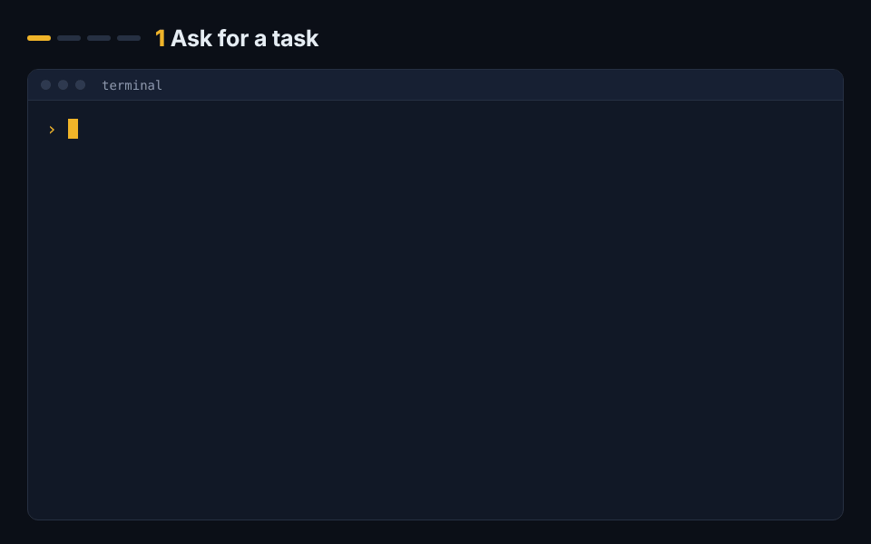

# i-miss-coding

**Your agent does the chores. You write the part that matters.**

English · [中文](README.zh-CN.md)



## Install

```bash
npx skills add gugusiyuan49/i-miss-coding
```

One `SKILL.md`, no dependencies. Works with Claude Code, Codex, Cursor, Gemini CLI, OpenCode
and other agents that read [Agent Skills](https://agentskills.io).

## Use

| Agent | Start a task with |
| --- | --- |
| Claude Code | `/i-miss-coding build a CLI expense tracker` |
| Codex | `$i-miss-coding build a CLI expense tracker` |
| Gemini CLI, Cursor and others | `I miss coding, leave the core to me: build a CLI expense tracker` |

Then say `hint` when you're stuck, `done` when you've written it, or `you write it` to bail out.

## What happens

| Normal agent | With i-miss-coding |
| --- | --- |
| Writes all 200 lines | Writes the setup, wiring and tests |
| You skim and accept | You write the 5–25 lines that decide the behaviour |
| You can't explain it | Tests tell you when you're right |

A handover looks like this ([examples/demo-task](examples/demo-task)):

```text
Your turn: `summary.py` -> `monthly_totals()`
What it does: Adds up the spending for each month.
Watch out for: the same month in two years, unsorted input, 0.1 + 0.2
Check it with: `python3 -m unittest`
Say "done" when finished, or "hint" if stuck.
```

No agent handy? Run `python3 -m unittest` inside `examples/demo-task`, fill in
`monthly_totals()` in `summary.py`, and run it again.

## The rules

The agent follows ten short rules ([full text](skills/i-miss-coding/SKILL.md)). The ones you'll notice:

- **One gap at a time.** Exactly one `TODO(human)`, with inputs, outputs, edge cases and a hint. Never the answer.
- **Tests define done.** They fail when you start and pass when you're right.
- **Review, don't rewrite.** After `done` you get the test result and at most three points.
- **Hint ladder.** Each `hint` climbs one step: the idea, then pseudocode, then the code.
- **No real core, no gap.** Renames and config changes just get done.
- **Easy exit.** `you write it` switches back to normal mode. No lecture.

## Why I made this

I'm a student preparing for internship interviews, and the coding rounds still mean writing
the logic myself, with no agent to lean on. So I made my agent leave that part to me: it sets
up the project and the tests, I write the lines that matter, and the tests tell me if I got
it right.

## Tested on

Every agent gets the same tasks from `python3 scripts/eval.py <agent>`.
Full results are in [examples/test-log.md](examples/test-log.md).

<!-- preflight: replace the line below with real runs, e.g. "- Codex 0.63.0 · 2026-11-24 · 10/10 checks" -->
- Testing in progress. Results land here before v0.1.0.

## How it compares

- **Claude Code's Learning output style** is where the idea comes from; it also leaves
  `TODO(human)` markers. i-miss-coding works in any agent that reads skills, keeps it to one
  gap backed by tests, and adds the hint ladder.
- **[learning-opportunities](https://github.com/DrCatHicks/learning-opportunities)** offers
  short exercises about code the agent already wrote. Here you write the core of the real task
  yourself. The two work fine together.

## Credits

Inspired by Claude Code's Learning output style and its `TODO(human)` markers.

## License

[MIT](LICENSE)
