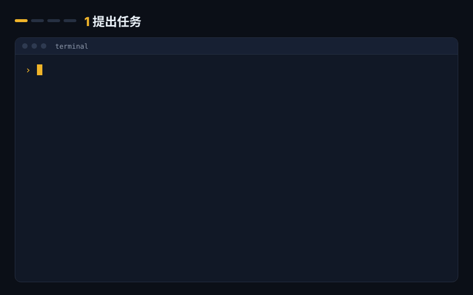

# i-miss-coding（留一手）

**杂活给 AI，核心留给你。**

[English](README.md) · 中文



## 安装

```bash
npx skills add gugusiyuan49/i-miss-coding
```

只有一个 `SKILL.md`，没有任何依赖。Claude Code、Codex、Cursor、Gemini CLI、OpenCode
等支持 [Agent Skills](https://agentskills.io) 的编程 agent 都能用。

## 怎么用

| Agent | 这样开头 |
| --- | --- |
| Claude Code | `/i-miss-coding 用 Python 写一个命令行记账工具` |
| Codex | `$i-miss-coding 用 Python 写一个命令行记账工具` |
| Gemini CLI、Cursor 等 | `留一手，核心留给我写：用 Python 写一个命令行记账工具` |

卡住了说 `hint`，写完了说 `done`，不想写了说「还是你写吧」。

## 会发生什么

| 普通 agent | 装了留一手 |
| --- | --- |
| 200 行全写完 | 写好项目骨架、接线和测试 |
| 你扫一眼就接受 | 你亲手写决定程序行为的那 5–25 行 |
| 你讲不清它干了什么 | 测试告诉你写没写对 |

交接消息长这样（[examples/demo-task](examples/demo-task)）：

```text
轮到你了：`summary.py` -> `monthly_totals()`
要做什么：把每个月的支出加起来。
注意：不同年份的同一个月、输入没排好序、0.1 + 0.2
检查方法：`python3 -m unittest`
写完说 "done"，卡住了说 "hint"。
```

手边没有 agent？在 `examples/demo-task` 里跑 `python3 -m unittest`，把 `summary.py`
里的 `monthly_totals()` 写完，再跑一次。

## 规则

agent 按十条短规则做事（[全文](skills/i-miss-coding/SKILL.md)），你最能感觉到的是这几条：

- **一次只留一个空**：只留一个 `TODO(human)`，写清输入输出、边界情况和一句提示，不给答案。
- **测试说了算**：刚开始测试是红的，写对了就变绿。
- **只点评，不重写**：说 `done` 之后，只告诉你测试结果和最多三条意见。
- **提示阶梯**：每说一次 `hint` 往上走一级：思路 → 伪代码 → 代码。
- **没核心就不留空**：改名、改配置这类活直接做完。
- **随时退出**：说「还是你写吧」就切回正常模式，不说教。

## 为什么做这个

我是一名正在准备实习面试的学生。面试的编程环节还是得自己写逻辑，没有 agent 可以靠。
所以我让 agent 把这部分留给我：它搭项目、写测试，我写真正关键的那几行，测试告诉我对不对。

## 测试过的 agent

每个 agent 都跑同一组任务：`python3 scripts/eval.py <agent>`。
完整结果见 [examples/test-log.md](examples/test-log.md)。

<!-- preflight: 把下面这行换成真实结果，例如 "- Codex 0.63.0 · 2026-11-24 · 10/10" -->
- 测试进行中，v0.1.0 发布前会更新在这里。

## 和同类项目的区别

- **Claude Code 的 Learning 输出风格**：最早的灵感来源，它也会留 `TODO(human)`。留一手能在任何读
  skill 的 agent 里用，每次只留一个空并配好测试，还有提示阶梯。
- **[learning-opportunities](https://github.com/DrCatHicks/learning-opportunities)**：在 agent
  写完代码之后给你出练习题。留一手是让你亲手写真实任务里的核心。两个可以一起用。

## 致谢

灵感来自 Claude Code 的 Learning 输出风格和它的 `TODO(human)` 标记。

## License

[MIT](LICENSE)
